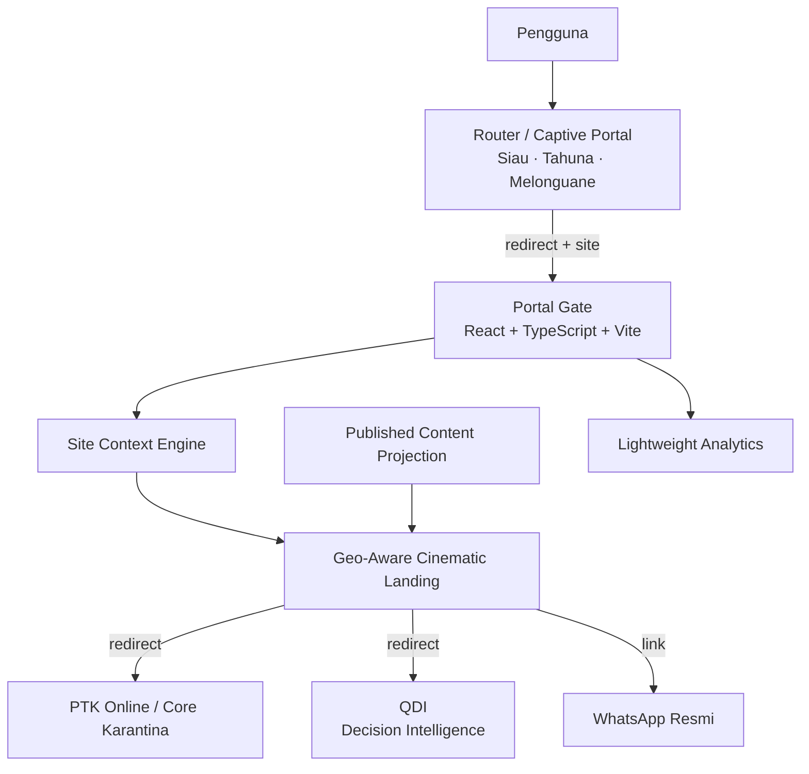
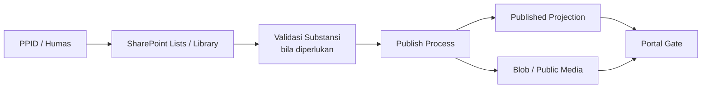
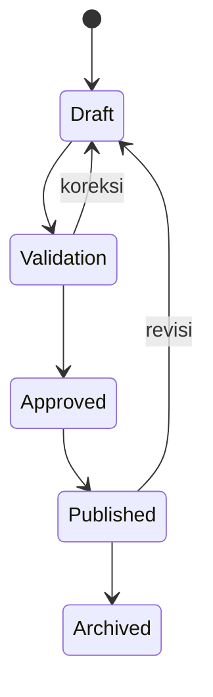
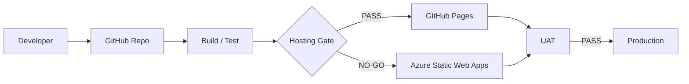
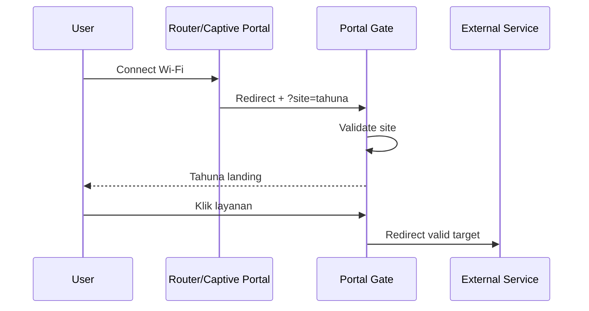
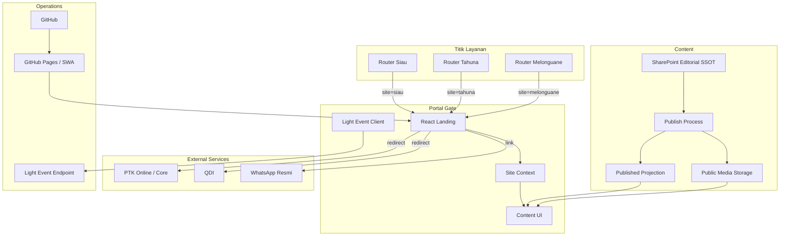

# PRODUCT REQUIREMENTS DOCUMENT (PRD)
## PORTAL GATE BKHIT SULAWESI UTARA
### Geo-Aware Digital Gateway untuk Akses Layanan dan Informasi Karantina

**Versi:** 2.0  
**Status:** DETERMINISTIK — BASELINE IMPLEMENTASI  
**Tanggal:** 20 Oktober 2026  
**Kegiatan:** Peningkatan Akses Layanan dan Informasi BKHIT Sulawesi Utara di Wilayah Kepulauan  
**Cara Pengadaan:** Swakelola Tipe I  
**Lokasi Prioritas:** Siau, Tahuna, Melonguane  
**Pemilik Produk:** BKHIT Sulawesi Utara  
**Tujuan Dokumen:** Menjadi acuan produk dan implementasi Portal Gate, tanpa menggantikan KAK, SK Penyelenggara, keputusan PPK/KPA, atau dokumen pengadaan resmi.

---

# 1. Prinsip Produk

Portal Gate harus sederhana, modern, ringan, dapat diukur, dan dapat dipertanggungjawabkan. Arsitektur tidak boleh heavy atau over-engineered.

Prinsip implementasi:

```text
Jika redirect cukup
→ jangan membuat integrasi API.

Jika static frontend cukup
→ jangan membuat server untuk fungsi tersebut.

Jika SharePoint cukup sebagai authoring
→ jangan membuat CMS baru.

Jika event counter cukup
→ jangan membuat analytics platform besar.

Jika satu codebase cukup
→ jangan membuat aplikasi terpisah per lokasi.

Jika fitur tidak dibutuhkan KAK/UAT
→ jangan memasukkannya ke baseline.
```

---

# 2. Tujuan Produk

Portal Gate merupakan satu pintu akses digital BKHIT Sulawesi Utara yang menghubungkan pengguna dengan:

1. layanan inti resmi Karantina/ PTK Online;
2. Quarantine Decision Intelligence (QDI);
3. informasi dan sosialisasi layanan yang dikelola PPID/Humas;
4. kanal WhatsApp resmi sebagai entry point interaksi;
5. pengalaman landing page yang menyesuaikan lokasi Siau, Tahuna, Melonguane, atau Sulawesi Utara umum.

Portal Gate bukan sistem transaksi baru dan tidak menggantikan sistem inti Badan Karantina Indonesia.

---

# 3. Traceability terhadap Output Swakelola

| Output | Keterkaitan Portal Gate | Implementasi dalam PRD |
|---|---|---|
| **O-01 Media Integrasi Akses dan Informasi** | Portal sebagai pintu akses digital | Landing page, PTK redirect, QDI redirect, content, WA entry |
| **O-02 Decision Intelligence** | QDI dapat diakses melalui Portal | Redirect/deep-link ke QDI; tidak menduplikasi QDI |
| **O-03 Konten Layanan dan Sosialisasi** | Konten terstruktur dan dikelola PPID/Humas | SharePoint authoring → published projection → Portal |
| **O-04 Konektivitas dan Ketahanan Daya** | Router/AP menjadi entry ke Portal di tiga titik | Captive redirect + `site context` + E2E test |
| **O-05 Operasional, Pengujian, Adopsi, Dokumentasi** | Portal harus dapat diuji dan dibuktikan pemanfaatannya | Lightweight analytics, UAT, SOP, evidence, closure |

---

# 4. Keputusan Arsitektur Terkunci

## ARCH-01 — Frontend Technology — LOCKED

Frontend Portal Gate menggunakan:

- React 19;
- TypeScript;
- Vite;
- Tailwind CSS 4;
- Motion;
- React Router;
- TanStack Query;
- Lucide Icons;
- Playwright untuk pengujian critical flow.

Prinsip:

- satu codebase;
- tidak membuat aplikasi berbeda untuk Siau, Tahuna, dan Melonguane;
- cinematic experience dibangun dengan asset ringan dan motion, bukan engine 3D berat.

## ARCH-02 — Portal sebagai Access/Orchestration Layer — LOCKED

Sistem berikut tetap terpisah:

- PTK Online/Core Karantina;
- QDI;
- Content authoring PPID/Humas;
- WhatsApp service.

Portal mengintegrasikan pengalaman pengguna menggunakan:

1. redirect/deep-link sebagai default;
2. API hanya bila pertukaran data memang dibutuhkan dan berwenang.

Tidak ada copy source code, database, atau business logic sistem eksternal ke Portal.

## ARCH-03 — Captive Portal Site Context — LOCKED

Router/captive portal mengarahkan pengguna ke satu domain Portal dengan context lokasi.

Contoh:

```text
https://<portal-domain>/?site=siau
https://<portal-domain>/?site=tahuna
https://<portal-domain>/?site=melonguane
```

Allowlist site:

```text
siau
tahuna
melonguane
sulut
```

Nilai selain daftar di atas dianggap invalid dan diarahkan ke konteks `sulut`.

Parameter site tidak boleh membawa nama, nomor telepon, MAC address, credential, atau identifier pribadi lainnya.

## ARCH-04 — Geo-Aware Experience — LOCKED

Urutan penentuan lokasi:

```text
1. router/captive portal site parameter
2. remembered site
3. browser geolocation opsional dengan consent
4. default Sulawesi Utara
```

Geo-context memengaruhi:

- hero/visual;
- label wilayah;
- informasi lokasi;
- prioritas konten lokal;
- site context pada analytics.

Geo-context tidak mengubah hak akses pengguna.

Lokasi GPS presisi tidak disimpan sebagai analytics baseline.

## ARCH-05 — Content & Media — LOCKED

Model:

```text
SharePoint/M365
= Editorial Content SSOT

Published Projection
= data publik yang sudah disanitasi

Blob/Object Storage
= delivery media publik bila dibutuhkan

Portal
= presentation layer
```

Portal publik tidak bergantung pada anonymous SharePoint sharing.

PPID/Humas menggunakan SharePoint Online sebagai authoring surface sehingga tidak perlu GitHub, edit source code, build, atau redeploy Portal.

Custom CMS terpisah bukan baseline.

## ARCH-06 — WhatsApp Extension-Ready — LOCKED

Baseline 2026:

```text
Portal
→ tombol "Tanya Karantina"
→ kanal WhatsApp resmi
```

Full WhatsApp API automation:

- disiapkan extension point;
- bukan syarat acceptance 2026;
- bukan syarat BAST;
- dapat dikembangkan pada fase lanjutan.

## ARCH-07 — Lightweight Auditable Analytics — LOCKED

Portal mencatat event minimum untuk membuktikan akses, adopsi, redirect layanan, dan interaksi konten.

Tidak membangun analytics platform yang heavy dan tidak menyimpan PII yang tidak diperlukan.

## ARCH-08 — Hosting Strategy — LOCKED

Urutan hosting:

```text
Preferred:
GitHub Pages

Fallback:
Azure Static Web Apps
```

Source code dan CI/CD berada di GitHub.

GitHub Pages dipakai bila seluruh deployment gate lulus. Azure Static Web Apps digunakan bila GitHub Pages tidak memenuhi kebutuhan material seperti routing, auth, API integration, staging, custom domain, atau security requirement.

Secret-bearing operation selalu berada di server-side/backend dan tidak disimpan di frontend.

## ARCH-09 — Security & Ownership — LOCKED

Aset strategis berada di bawah kontrol institusi, termasuk repository, domain/DNS, Microsoft 365 tenant, SharePoint, Azure resources, storage, backend, secrets, serta recovery/admin access.

Akun personal developer tidak boleh menjadi sole owner.

## ARCH-10 — Acceptance & UAT — LOCKED

Acceptance berbasis fungsi, integrasi, tiga lokasi, keamanan, konten, analytics, evidence, dan closure.

Tampilan menarik saja tidak cukup untuk dinyatakan diterima.

---

# 5. Target Product Architecture



Prinsip:

> Portal mengorkestrasi akses, bukan mengambil alih sistem.

---

# 6. Information Architecture Landing Page

Portal adalah landing page, bukan website organisasi konvensional.

Struktur minimum:

```text
HERO REGIONAL
    ↓
PRIMARY SERVICE ACTIONS
    ↓
INFORMASI TERKINI
    ↓
LAYANAN / PANDUAN
    ↓
DECISION INTELLIGENCE ENTRY
    ↓
TITIK LAYANAN
    ↓
BANTUAN / WHATSAPP
    ↓
FOOTER RESMI
```

CTA utama:

```text
[ Akses Layanan Karantina ]
[ Decision Intelligence ]
[ Informasi & Sosialisasi ]
[ Tanya Karantina ]
```

Tidak memerlukan navigasi multi-level yang kompleks.

---

# 7. Regional Experience

## 7.1 Context registry

```text
sulut
siau
tahuna
melonguane
```

Setiap context memiliki:

- display name;
- hero image;
- subtitle;
- service point label;
- optional local announcement;
- contact/location metadata;
- theme token.

## 7.2 Siau

Landing menampilkan visual/iconic context Siau.

## 7.3 Tahuna

Landing menampilkan visual/iconic context Tahuna/Sangihe.

## 7.4 Melonguane

Landing menampilkan visual/iconic context Melonguane/Talaud.

## 7.5 Sulawesi Utara

Fallback menggunakan identitas umum BKHIT Sulawesi Utara.

## 7.6 Cinematic rule

Baseline cinematic menggunakan:

- optimized still image;
- gradient layering;
- typography hierarchy;
- subtle Motion transition;
- parallax ringan bila lolos performance;
- micro-interaction CTA.

Tidak baseline:

- Three.js;
- WebGL scene berat;
- autoplay full-screen video;
- heavy background media.

`prefers-reduced-motion` wajib dihormati.

---

# 8. Site Context Engine

Pseudo-logic:

```text
IF URL site parameter valid
    use URL site
ELSE IF remembered site valid
    use remembered site
ELSE IF user voluntarily requests browser location
    map location to known site
ELSE
    use "sulut"
```

Site context tidak boleh digunakan sebagai arbitrary redirect input.

External service URL selalu berasal dari trusted configuration.

---

# 9. Service Integration

## 9.1 PTK Online / Core Karantina

Baseline:

```text
Portal CTA
→ validated official PTK URL
→ redirect
```

Portal tidak:

- membuat form transaksi pengganti;
- mengambil credential PTK;
- menyimpan data transaksi PTK;
- mem-proxy transaksi.

**Production URL: VERIFY sebelum UAT.**

## 9.2 QDI

Baseline:

```text
Portal CTA
→ QDI
```

QDI tetap aplikasi, repository, deployment, dan owner business logic yang terpisah.

Portal tidak:

- iframe QDI sebagai baseline;
- membaca database QDI langsung;
- menyalin dashboard QDI;
- mem-fork QDI khusus Sulawesi Utara.

Jika QDI mempunyai deep-link region resmi, Portal dapat meneruskan scope Sulawesi Utara. Jika belum tersedia, Portal membuka entry QDI yang sah.

**Format deep-link region: VERIFY terhadap contract QDI sebelum implementasi.**

## 9.3 PPID/Humas

Portal membaca published projection, bukan authoring repository langsung dari browser publik.

## 9.4 WhatsApp

Baseline:

```text
Portal
→ kanal WhatsApp resmi
```

Future:

```text
Portal
→ backend adapter
→ WhatsApp API
```

Future automation tidak menjadi acceptance baseline 2026.

---

# 10. Content Architecture



## 10.1 Authoring

PPID/Humas menggunakan SharePoint untuk:

- artikel;
- pengumuman;
- FAQ;
- informasi layanan;
- informasi titik layanan;
- metadata media;
- dokumen publik;
- status konten.

## 10.2 Public projection

Portal hanya membaca konten dengan status:

```text
PUBLISHED
```

Draft/internal/review tidak boleh terekspos ke publik.

## 10.3 Media publik

Gunakan media publik yang dioptimalkan. Blob/object storage dipakai bila memang diperlukan untuk performance atau akses publik yang stabil.

Video berat/autoplay tidak menjadi baseline.

---

# 11. Content Workflow



Validasi KH/KI/KT dilakukan bila substansi teknis memerlukannya.

PPID/Humas memegang fungsi publikasi sesuai kewenangan internal.

---

# 12. Content Data Model

| Field | Fungsi |
|---|---|
| `id` | identifier konten |
| `slug` | identifier URL/logical key |
| `title` | judul |
| `summary` | ringkasan |
| `body` | isi |
| `category` | kategori |
| `site_scope` | GLOBAL/SIAU/TAHUNA/MELONGUANE |
| `content_type` | article/announcement/faq/service/document/media |
| `source` | sumber substansi |
| `owner` | pemilik substansi |
| `validator` | validator bila diperlukan |
| `status` | DRAFT/VALIDATION/APPROVED/PUBLISHED/ARCHIVED |
| `media_url` | referensi media |
| `publish_at` | waktu publikasi |
| `expire_at` | waktu kedaluwarsa bila ada |
| `updated_at` | waktu pembaruan |
| `sort_order` | urutan tampilan |

Tidak perlu relational database khusus untuk model ini pada baseline.

---

# 13. Functional Requirements

## FR-001 — Portal availability

Portal harus memiliki production URL aktif melalui HTTPS.

## FR-002 — Site parameter

Portal menerima `site=siau`, `site=tahuna`, `site=melonguane`, dan `site=sulut`.

Nilai invalid → fallback `sulut`.

## FR-003 — Direct access

Portal tetap berfungsi jika user membuka domain secara langsung tanpa captive portal.

## FR-004 — Manual location switch

User dapat mengganti context lokasi secara manual.

## FR-005 — PTK launcher

CTA PTK membuka URL layanan resmi yang sudah diverifikasi.

## FR-006 — QDI launcher

CTA QDI membuka QDI yang telah ditetapkan.

## FR-007 — Content display

Portal menampilkan konten published sesuai `site_scope`.

## FR-008 — Content fallback

Jika tidak ada konten lokal, Portal menampilkan konten GLOBAL.

## FR-009 — WhatsApp entry

Portal menyediakan CTA “Tanya Karantina” menuju kanal resmi.

## FR-010 — Analytics events

Portal mencatat event baseline sesuai event contract.

## FR-011 — Content management

PPID/Humas dapat memperbarui/mempublish konten tanpa mengubah source Portal.

## FR-012 — Draft protection

Konten non-published tidak dapat dibaca oleh public Portal.

## FR-013 — Responsive

Portal berfungsi pada mobile dan desktop.

## FR-014 — Graceful failure

Kegagalan satu sumber konten/media tidak boleh membuat seluruh Portal blank/crash.

## FR-015 — Service allowlist

External redirect hanya menuju URL target yang dikonfigurasi.

Tidak boleh menerima arbitrary redirect URL dari query parameter.

---

# 14. Lightweight Analytics

## 14.1 Event baseline

```text
portal_view
ptk_redirect
qdi_redirect
content_view
whatsapp_click
site_switch
```

## 14.2 Event schema

Minimum:

```text
event_name
timestamp
session_id
site_context
entry_source
target
content_id (optional)
device_class
release_version
```

`session_id` bersifat random/pseudonymous dan tidak digunakan untuk mengidentifikasi orang.

## 14.3 Entry source

```text
captive_portal
direct
referral
```

## 14.4 Data yang tidak dicatat

Baseline tidak mencatat:

- nama;
- NIK;
- nomor telepon;
- email;
- MAC address;
- GPS presisi;
- isi percakapan WA;
- credential;
- data transaksi PTK.

## 14.5 Output analytics

Tidak perlu dashboard analytics kompleks.

Output minimum berupa rekap:

```text
Periode
Site
Portal Visit
PTK Redirect
QDI Redirect
Content Interaction
WhatsApp Click
```

Setiap angka harus berasal dari event aktual.

---

# 15. Lightweight Backend

Backend hanya dibuat untuk fungsi yang tidak aman atau tidak tepat dilakukan di browser.

Baseline responsibilities:

1. menerima analytics events;
2. membantu published projection bila mekanisme tenant memerlukannya;
3. menjadi future integration adapter.

Tidak baseline:

- business logic PTK;
- data warehouse;
- QDI backend replacement;
- custom CMS besar;
- WhatsApp automation engine penuh.

## 15.1 Content publication mechanism

Target behavior:

```text
SharePoint approved content
→ sanitized published projection
→ public Portal
```

Preferred implementation bila tersedia:

```text
Logic Apps
```

Fallback bila permission/connector tidak memungkinkan:

```text
Azure Function + Microsoft Graph
```

Acceptance ditentukan oleh hasil fungsi, bukan merek komponen.

---

# 16. Hosting & Deployment

## 16.1 Source control

```text
GitHub Repository
```

Branching minimal:

```text
main       = production-ready
develop    = optional integration branch
feature/*  = temporary work
```

Tidak perlu branching model kompleks.

## 16.2 Preferred hosting

```text
GitHub Pages
```

## 16.3 Fallback

```text
Azure Static Web Apps
```

## 16.4 GO/NO-GO GitHub Pages

GitHub Pages dapat menjadi production host bila:

| Gate | Syarat |
|---|---|
| GH-01 | custom domain/HTTPS berfungsi |
| GH-02 | captive redirect berfungsi |
| GH-03 | `site` context berfungsi |
| GH-04 | React/Vite production build stabil |
| GH-05 | published content dapat dibaca |
| GH-06 | analytics endpoint dapat menerima event |
| GH-07 | tidak ada secret di frontend |
| GH-08 | mobile performance layak |
| GH-09 | UAT tiga titik lulus |

Jika gate material gagal:

```text
NO-GO GitHub Pages
→ deploy Azure Static Web Apps
```

Codebase tidak perlu diubah secara arsitektural.

---

# 17. Deployment Flow



Build minimum:

```text
typecheck
lint
build
critical tests
```

E2E Playwright difokuskan pada critical flow, bukan seluruh UI detail.

---

# 18. Security Model

## 18.1 Public surface

Portal public bersifat anonymous untuk:

- membuka landing;
- membaca konten publik;
- membuka PTK;
- membuka QDI entry yang sah;
- membuka WhatsApp official link.

## 18.2 Editorial surface

PPID/Humas menggunakan Microsoft 365/institutional identity.

Authoring baseline dilakukan pada SharePoint Online.

## 18.3 Secret handling

Tidak boleh berada di frontend:

- Graph secret;
- Azure secret;
- storage key;
- WhatsApp token;
- API provider key;
- service credentials.

## 18.4 Ownership

Institutional control wajib untuk:

```text
GitHub repo
domain/DNS
tenant
SharePoint
Azure resources
storage
backend
recovery access
```

Akun pribadi developer tidak boleh menjadi satu-satunya recovery path.

---

# 19. Non-Functional Requirements

## NFR-01 — Simplicity

Jumlah komponen dijaga minimum.

## NFR-02 — Mobile-first

Prioritas pengalaman adalah perangkat mobile.

## NFR-03 — Bandwidth-aware

Landing harus tetap berguna pada koneksi kepulauan.

Baseline:

- tidak ada autoplay heavy video;
- lazy-load media non-critical;
- responsive image;
- AVIF/WebP bila sesuai;
- visual decorative gagal → fungsi utama tetap berjalan.

## NFR-04 — Accessibility

Minimum:

- semantic HTML;
- keyboard navigation;
- contrast memadai;
- alt text;
- `prefers-reduced-motion`;
- focus state terlihat.

## NFR-05 — Resilience

Kegagalan konten eksternal tidak boleh memutus CTA PTK/QDI utama.

## NFR-06 — Auditability

Release, UAT, temuan, dan closure dapat ditelusuri.

## NFR-07 — Maintainability

Developer baru harus dapat memahami site config, service config, content contract, event contract, dan deployment flow tanpa membaca seluruh codebase terlebih dahulu.

---

# 20. Configuration Model

Contoh logical configuration:

```ts
type SiteKey = 'sulut' | 'siau' | 'tahuna' | 'melonguane'

type SiteConfig = {
  key: SiteKey
  label: string
  heroAsset: string
  subtitle: string
  servicePointLabel?: string
}
```

Service target:

```ts
type ServiceTarget = {
  key: 'ptk' | 'qdi' | 'whatsapp'
  label: string
  url: string
  enabled: boolean
}
```

URL layanan harus berasal dari trusted configuration.

---

# 21. Publication Contract

Portal mengonsumsi published projection dengan logical contract seperti:

```json
{
  "generatedAt": "2026-10-20T12:00:00Z",
  "items": [
    {
      "id": "abc",
      "slug": "persyaratan-layanan",
      "title": "Persyaratan Layanan",
      "summary": "...",
      "category": "service",
      "siteScope": "GLOBAL",
      "status": "PUBLISHED",
      "mediaUrl": null,
      "updatedAt": "2026-10-20T10:00:00Z"
    }
  ]
}
```

Hanya field yang aman untuk publik masuk projection.

Authoring metadata internal tidak wajib dipublikasikan.

---

# 22. UX States

Portal wajib memiliki state:

```text
loading
ready
content-empty
content-error
invalid-site
offline/degraded
```

Perilaku:

### Invalid site

```text
fallback → sulut
```

### Content API gagal

```text
landing + PTK/QDI/WA CTA tetap berfungsi
```

### Hero image gagal

```text
fallback gradient/theme
```

### Analytics gagal

```text
tidak boleh menghalangi navigasi user
```

Analytics bersifat non-blocking.

---

# 23. Router / Captive Portal Integration

## 23.1 Target

Router pada tiga titik melakukan redirect ke Portal Domain + Site Context.

Contoh:

```text
Siau        → /?site=siau
Tahuna      → /?site=tahuna
Melonguane  → /?site=melonguane
```

## 23.2 Functional rule

Router hanya mengirim context lokasi.

Router tidak perlu mengirim user identity, MAC, nomor telepon, username, atau token personal.

## 23.3 End-to-end flow



---

# 24. Acceptance / UAT

| ID | Test | PASS bila |
|---|---|---|
| UAT-01 | Production URL | HTTPS dapat diakses |
| UAT-02 | Siau captive redirect | masuk Portal dengan `site=siau` |
| UAT-03 | Tahuna captive redirect | masuk Portal dengan `site=tahuna` |
| UAT-04 | Melonguane captive redirect | masuk Portal dengan `site=melonguane` |
| UAT-05 | Direct access | tanpa `site` tampil Sulawesi Utara |
| UAT-06 | Geo visual | tiap site menampilkan context regional sesuai |
| UAT-07 | Manual switch | lokasi dapat diganti tanpa error |
| UAT-08 | PTK | official target URL terbuka |
| UAT-09 | QDI | target QDI terbuka |
| UAT-10 | Humas publish | konten dapat dipublish tanpa edit source |
| UAT-11 | Draft protection | draft tidak terlihat publik |
| UAT-12 | Content site scope | GLOBAL/lokal tampil sesuai context |
| UAT-13 | WA entry | kanal WhatsApp resmi terbuka |
| UAT-14 | Analytics | event minimum tercatat |
| UAT-15 | No PII | tidak ada PII baseline pada event |
| UAT-16 | Responsive | fungsi utama lulus mobile & desktop |
| UAT-17 | Reduced motion | accessibility setting dihormati |
| UAT-18 | Content failure | CTA utama tetap berfungsi |
| UAT-19 | Invalid site | fallback ke Sulawesi Utara |
| UAT-20 | Secret scan | tidak ada secret pada client bundle/repo public |
| UAT-21 | Institutional control | recovery/admin access institusional tersedia |
| UAT-22 | Three-site E2E | uji nyata dilakukan dari tiga titik |
| UAT-23 | Evidence | tiap test memiliki bukti dan status |
| UAT-24 | Closure | tidak ada temuan kritis/material terbuka |

---

# 25. Format Evidence UAT

Setiap test case minimum mempunyai:

| Field | Isi |
|---|---|
| Test ID | UAT-xx |
| Date/Time | waktu pengujian |
| Site | Siau/Tahuna/Melonguane/Remote |
| Tester | personel penguji |
| Preconditions | kondisi awal |
| Action | langkah |
| Expected | hasil yang diharapkan |
| Actual | hasil aktual |
| Status | PASS/FAIL |
| Evidence | screenshot/log/link |
| Finding ID | bila gagal |
| Corrective Action | tindakan |
| Retest | hasil pengujian ulang |
| Closure | closed/open |

Tidak perlu tool UAT enterprise khusus. Register sederhana sudah cukup selama bukti dapat ditelusuri.

---

# 26. Definition of Done

Portal Gate dinyatakan **Done** apabila:

1. production URL aktif;
2. captive redirect tiga titik lulus;
3. geo-aware landing bekerja;
4. PTK redirect lulus;
5. QDI redirect lulus;
6. PPID/Humas dapat publish tanpa developer;
7. public content tidak bergantung pada anonymous SharePoint access;
8. WA official entry berfungsi;
9. analytics minimum tercatat;
10. tidak ada secret di frontend;
11. responsive/mobile lulus;
12. UAT tiga titik selesai;
13. temuan material ditutup;
14. SOP/manual minimum tersedia;
15. release/version terdokumentasi;
16. aset strategis dapat dikendalikan institusi.

---

# 27. Out of Scope Baseline 2026

Tidak menjadi syarat BAST Portal Gate:

- mengganti PTK Online;
- membuat transaksi karantina di Portal;
- sinkronisasi database PTK;
- QDI clone/fork khusus Sulawesi Utara;
- direct database connection ke QDI;
- iframe QDI sebagai baseline;
- custom enterprise CMS;
- data warehouse analytics Portal;
- user profiling;
- precise geolocation tracking;
- full WhatsApp bot/API automation;
- AI chatbot publik;
- Three.js/WebGL cinematic environment;
- heavy video streaming platform;
- native mobile app;
- SSO publik ke seluruh layanan;
- recommendation engine.

Perubahan terhadap daftar ini harus melalui change control.

---

# 28. Change Control

Perubahan dianggap material apabila mengubah:

- fungsi acceptance;
- kebutuhan anggaran;
- hosting;
- security boundary;
- source of truth;
- pengolahan data personal;
- integrasi ke sistem pusat;
- scope O-01 s.d. O-05.

Format minimum:

```text
Change ID
Problem / Need
Current Baseline
Proposed Change
Impact
Cost
Risk
Authority / Approval
Decision
Effective Version
```

Tidak boleh melakukan scope creep melalui perubahan source code tanpa catatan keputusan.

---

# 29. Risiko Produk Utama

| Risiko | Level | Kontrol |
|---|---|---|
| Portal menjadi duplikasi PTK | Merah | redirect-only baseline |
| Integrasi QDI berkembang menjadi fork | Merah | QDI tetap aplikasi/repo terpisah |
| Public bergantung pada SharePoint anonymous | Merah | published projection |
| Secret masuk frontend | Merah | server-side only |
| Site parameter disalahgunakan untuk redirect | Merah | allowlist + fixed service config |
| Cinematic membuat portal berat | Kuning | optimized still + light Motion |
| Content stale | Kuning | owner/status/update metadata |
| Analytics menjadi tracking personal | Kuning | event minimal, tanpa PII |
| GitHub Pages tidak memenuhi deployment gate | Kuning | fallback SWA |
| One-person dependency | Kuning | institutional ownership + documentation |
| External PTK/QDI URL berubah | Kuning | configuration + pre-UAT verification |

---

# 30. Source of Truth Register

| Domain | Source of Truth |
|---|---|
| Transaksi karantina | Sistem resmi Badan Karantina Indonesia |
| Decision context | QDI |
| Editorial content | SharePoint/M365 |
| Published content | Derived projection dari editorial SSOT |
| Public media | Blob/object delivery copy bila digunakan |
| Portal UI/config | GitHub repository Portal |
| Site context | Router parameter / trusted Portal state |
| Usage evidence | Portal event log |
| Acceptance | UAT register + evidence |
| Keputusan baseline | PRD ini + change log |

Published projection bukan SSOT editorial baru.

---

# 31. Implementation Plan Minimal

## Phase 1 — Foundation

- repository;
- React/Vite setup;
- design tokens;
- site configuration;
- service URL config;
- production build.

## Phase 2 — Landing

- general Sulut landing;
- regional hero Siau;
- regional hero Tahuna;
- regional hero Melonguane;
- primary CTA;
- responsive behavior.

## Phase 3 — Integration

- router context;
- PTK redirect;
- QDI redirect;
- WA link;
- fallback/error handling.

## Phase 4 — Content

- SharePoint authoring structure;
- publish workflow;
- published projection;
- content card/detail;
- site-scoped content.

## Phase 5 — Measurement & Control

- lightweight event endpoint;
- event register;
- release evidence;
- security checks.

## Phase 6 — UAT & Go-Live

- Siau;
- Tahuna;
- Melonguane;
- closure;
- production acceptance;
- SOP/handover.

Tidak perlu microservice decomposition atau platform engineering terpisah.

---

# 32. Final Architecture



---

# 33. Ringkasan Baseline

Portal Gate BKHIT Sulawesi Utara adalah:

> **Satu landing page digital modern dan geo-aware yang menjadi pintu masuk dari jaringan titik layanan menuju PTK Online, QDI, informasi/sosialisasi PPID/Humas, dan kanal WhatsApp resmi; menggunakan satu codebase React, konten institusional yang dapat diperbarui tanpa developer, analytics ringan yang dapat dipertanggungjawabkan, serta deployment GitHub-first dengan Azure Static Web Apps sebagai fallback.**

Keberhasilan Portal tidak dinilai dari banyaknya teknologi.

Keberhasilan Portal dinilai dari:

```text
mudah diakses
+ tepat mengarahkan
+ sesuai konteks lokasi
+ konten dapat dipelihara
+ ringan
+ aman
+ terukur
+ dapat diuji
+ dapat dibuktikan
```

---

# 34. Checklist Sebelum Build

## LOCKED

- [x] React + TypeScript + Vite
- [x] Tailwind + Motion
- [x] Portal sebagai gateway
- [x] satu codebase
- [x] router `site context`
- [x] geo-aware landing
- [x] SharePoint editorial SSOT
- [x] public tidak tergantung anonymous SharePoint
- [x] Blob/media selective
- [x] WhatsApp link baseline, API future
- [x] lightweight analytics
- [x] GitHub Pages preferred
- [x] SWA fallback
- [x] institutional ownership
- [x] UAT tiga titik
- [x] no heavy / no over-engineering

## VERIFY SEBELUM PRODUCTION

- [ ] production domain
- [ ] URL PTK resmi
- [ ] URL/route QDI production
- [ ] dukungan QDI deep-link region bila ada
- [ ] nomor/kanal WhatsApp resmi
- [ ] SharePoint site/list/library aktual
- [ ] akun PPID/Humas
- [ ] tenant/app permission bila publish automation diperlukan
- [ ] storage endpoint bila Blob digunakan
- [ ] router captive portal config per titik
- [ ] institutional GitHub ownership/recovery
- [ ] hasil hosting GO/NO-GO
- [ ] bukti UAT Siau
- [ ] bukti UAT Tahuna
- [ ] bukti UAT Melonguane

---

# 35. Control / Close

## Rekomendasi inti

Gunakan PRD ini sebagai baseline build, bukan daftar teknologi yang harus terus ditambah.

Jika ditemukan kebutuhan baru:

1. cek apakah diperlukan untuk O-01 s.d. O-05;
2. cek apakah dapat dipenuhi dengan komponen existing;
3. ukur dampak biaya, waktu, security, dan UAT;
4. lakukan change control hanya jika material.

## Status risiko

- **Hijau:** Portal sebagai gateway, satu codebase, redirect PTK/QDI, lightweight analytics.
- **Kuning:** final domain, final URL target, permission SharePoint/publish process, hosting GO/NO-GO, captive portal configuration.
- **Merah bila terjadi:** integrasi sistem pusat tanpa kewenangan, public exposure konten internal, secret di frontend, copy/fork QDI tanpa dasar, tracking data personal yang tidak diperlukan.

## Bukti minimum yang harus disimpan

- PRD/version history;
- repo/release tag;
- build/test result;
- configuration register;
- screenshot landing empat context;
- evidence captive redirect tiga titik;
- content publish evidence;
- analytics sample;
- UAT register;
- temuan dan closure;
- SOP;
- BA/pemeriksaan/serah terima sesuai tahapan resmi.

---

**END OF PRD v2.0**
