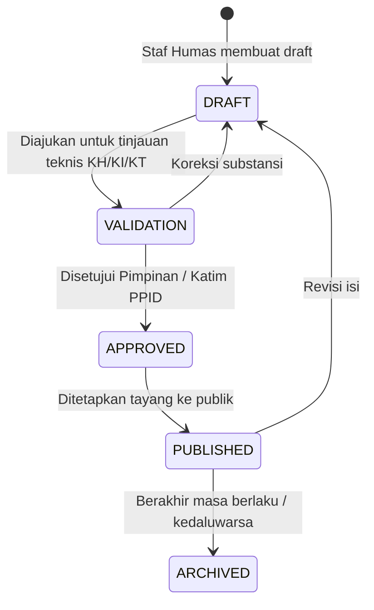

# Panduan Penyiapan SharePoint Online (PPID / Humas SSOT)

> Berdasarkan [PRD v2.0 Deterministik](file:///d:/Project/PortalLayanan/public/PRD_Portal_Gate_BKHIT_Sulut_v2_Deterministik.md) (§10, §11, §12, §21) dan [Content Contract](file:///d:/Project/PortalLayanan/docs/content-contract.md).

---

## 1. Latar Belakang & Prinsip `ARCH-05`

Portal Gate BKHIT Sulawesi Utara dirancang agar **tim PPID/Humas dapat menerbitkan pengumuman, panduan layanan, dan berita edukasi karantina secara mandiri tanpa memerlukan bantuan programmer atau menyentuh source code**.

- **SharePoint Online / Microsoft 365** bertindak sebagai *Single Source of Truth* (SSOT) editorial internal.
- **Portal Publik** hanya membaca berkas *Published Projection (JSON)* yang telah disanitasi.
- **Draft Protection (UAT-11)**: Artikel berstatus `DRAFT`, `VALIDATION`, atau `INTERNAL` tidak akan pernah tampil ke publik.

---

## 2. Langkah Membuat SharePoint List

1. Buka situs SharePoint PPID / Kehumasan BKHIT Sulawesi Utara di Microsoft 365.
2. Klik tombol **+ New** > pilih **List** > pilih **Blank list**.
3. Beri nama daftar: `KarantinaPublicContent` (atau nama lain yang disepakati).
4. Tambahkan kolom-kolom berikut sesuai tabel di bawah.

---

## 3. Struktur Kolom SharePoint List (Sesuai PRD §12)

| Nama Kolom | Tipe Data Kolom di SharePoint | Pengaturan / Pilihan (*Choices*) | Fungsi |
|---|---|---|---|
| `Title` | Single line of text (Bawaan) | Wajib diisi (*Required*) | Judul artikel / pengumuman |
| `slug` | Single line of text | Huruf kecil & strip, contoh: `panduan-ptk-online` | Kunci unik pengenal artikel |
| `summary` | Multiple lines of text | Plain text, 1-2 kalimat ringkas | Ringkasan yang tampil di kartu depan |
| `body` | Multiple lines of text | Use enhanced rich text (Bold, bullets, dll) | Isi lengkap artikel/panduan |
| `category` | Choice | `service`<br/>`announcement`<br/>`article`<br/>`faq`<br/>`document` | Kategori untuk tab filter |
| `site_scope` | Choice | `GLOBAL`<br/>`SIAU`<br/>`TAHUNA`<br/>`MELONGUANE` | Penentu wilayah pos pulau |
| `content_type` | Choice | `service`<br/>`announcement`<br/>`faq`<br/>`article`<br/>`document` | Tipe konten teknis |
| `status` | Choice | `DRAFT`<br/>`VALIDATION`<br/>`APPROVED`<br/>`PUBLISHED`<br/>`ARCHIVED` | Status publikasi |
| `media_url` | Single line of text (Hyperlink/URL) | Opsional | Tautan gambar dokumentasi |
| `publish_at` | Date and Time | Date & Time | Waktu mulai tayang |
| `expire_at` | Date and Time | Date & Time (Opsional) | Waktu kedaluwarsa pengumuman |
| `sort_order` | Number | Integer (1, 2, 3...) | Urutan prioritas (angka 1 di atas) |

---

## 4. Alur Kerja Editorial Tim Humas (SOP Humas)



1. **Pembuatan Draf**: Staf Humas mengisi judul, ringkasan, dan isi di SharePoint List dengan status `DRAFT`.
2. **Penentuan Wilayah (`site_scope`)**:
   - Pilih `GLOBAL`: Jika informasi berlaku untuk seluruh Sulawesi Utara.
   - Pilih `SIAU`: Jika pengumuman khusus Pelabuhan Ulu Siau / Ondong / Tagulandang.
   - Pilih `TAHUNA`: Jika pengumuman khusus Pelabuhan Nusantara Tahuna / Bandara Naha.
   - Pilih `MELONGUANE`: Jika pengumuman khusus Pelabuhan Melonguane / Talaud.
3. **Penerbitan**: Ubah status menjadi `PUBLISHED`. Hanya item dengan status ini yang akan diekspor ke portal publik.

---

## 5. Pipeline Ekspor Otomatis (*Publish Process*)

Untuk menghubungkan SharePoint List ke Portal Gate, disiapkan alur otomatisasi menggunakan **Power Automate** (bawaan M365):

### Alur Power Automate:
1. **Trigger**: *When an item is created or modified* pada list `KarantinaPublicContent`.
2. **Condition**: Cek apakah status item adalah `PUBLISHED`.
3. **Action (Get items)**: Ambil seluruh item yang memiliki filter query:
   ```text
   status eq 'PUBLISHED'
   ```
4. **Action (Select & Sanitize)**: Buang kolom internal SharePoint (`Author`, `Editor`, `Created`, `ID Internal`).
5. **Action (Create/Update JSON File)**: Tulis file JSON dengan format:
   ```json
   {
     "generatedAt": "2026-11-01T12:00:00Z",
     "items": [
       {
         "id": "cnt-001",
         "slug": "panduan-ptk-online",
         "title": "...",
         "summary": "...",
         "body": "...",
         "category": "service",
         "siteScope": "GLOBAL",
         "status": "PUBLISHED",
         "updatedAt": "2026-11-01T10:00:00Z"
       }
     ]
   }
   ```
6. **Delivery**: Simpan berkas JSON ke Azure Blob Storage atau commit ke repository pada subpath `public/content/sample.json` (atau URL endpoint `VITE_CONTENT_PROJECTION_URL`).

---

## 6. Verifikasi & Pengujian

- **UAT-10**: Buktikan bahwa mengubah judul atau menambahkan pengumuman baru di SharePoint akan langsung tampil di portal tanpa menyentuh kodingan.
- **UAT-11**: Buat item baru dengan status `DRAFT`, buka portal, dan pastikan item tersebut **tidak muncul** di daftar berita publik.

